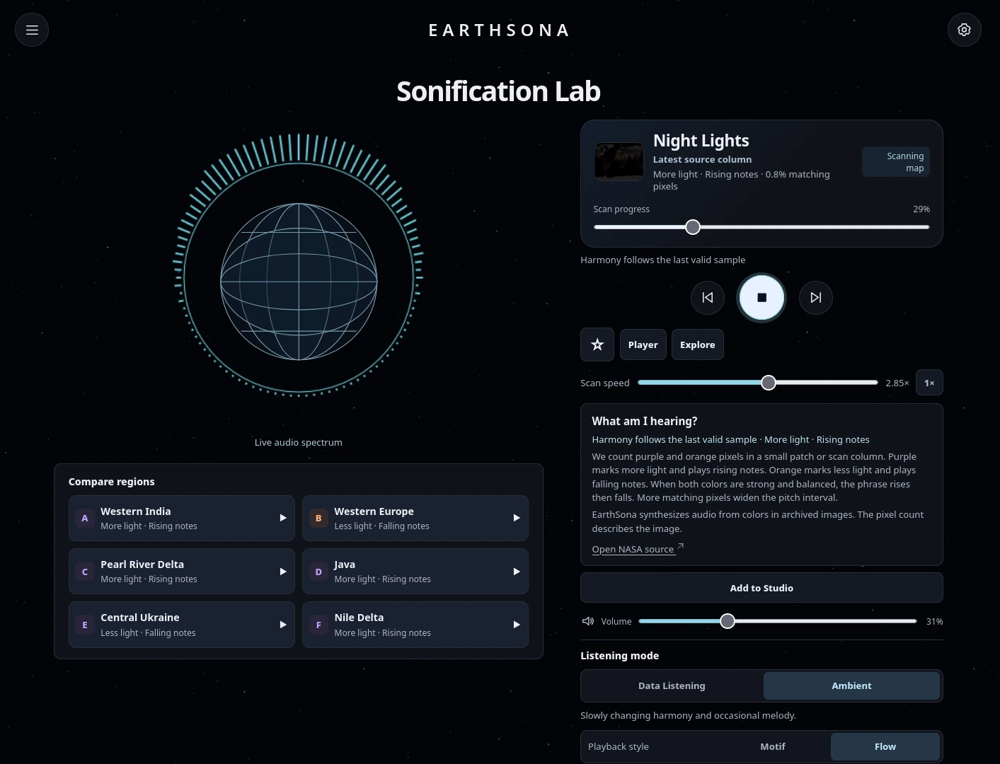
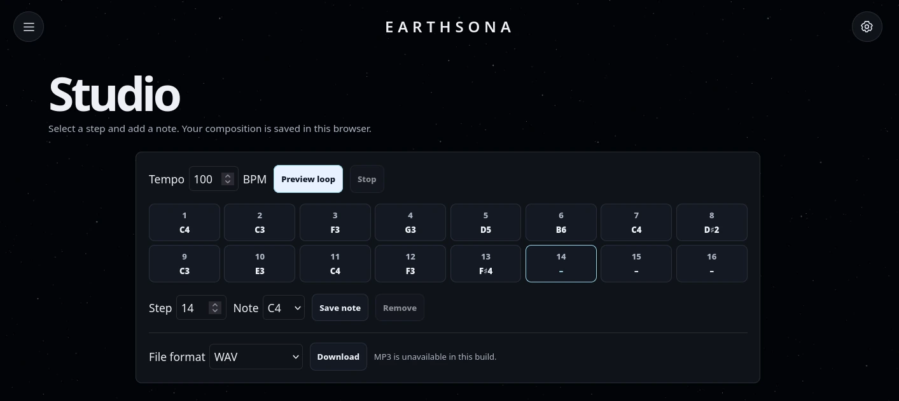
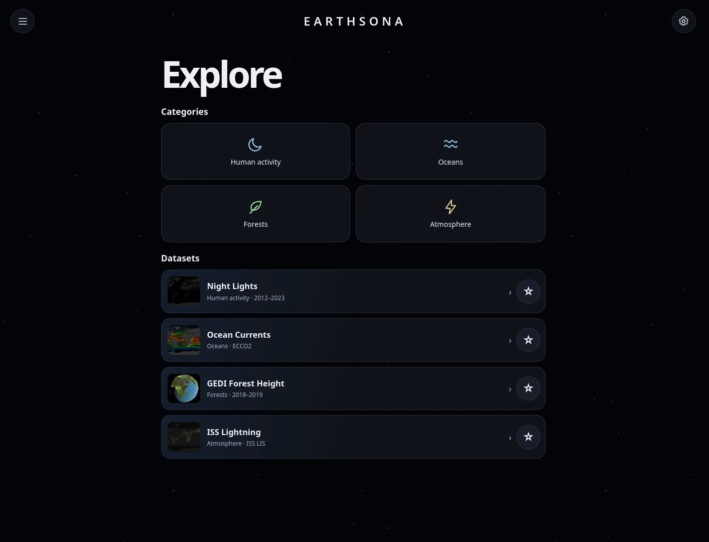

# EarthSona

EarthSona is an open-source, responsive web app by **Asteronix**, a team within **UHRET (Hackathon, Robotik ve Elektronik Topluluğu)**. It began with *The Earth Information Jukebox* challenge at the 2026 NASA Space Apps Challenge.

Choose a NASA Earth visualization, then select a region or scan across the image. EarthSona counts pixels that match the dataset's color rules in a patch or scan column. The categories determine whether pitches rise or fall, and the proportion of matching pixels affects the pitch interval. **Motif** plays short phrases. **Flow** arranges successive samples into phrases or sustained accompaniment. Pitch, harmony, and timing are musical choices, and the percentages describe the bundled image pixels.

<p><a href="docs/screenshots/iss-lightning-globe.webp"></a><br><em>ISS Lightning on the globe</em></p>

[Run locally](#run-locally) · [Try the demo](#demo-walkthrough) · [Contributing](CONTRIBUTING.md) · [Dataset guide](docs/DATASETS.md)

## Run locally

Clone [grassified/EarthSona](https://github.com/grassified/EarthSona) and open the project directory.

Use Node.js 22.12 or later in the Node 22 line. From the repository root:

```sh
npm ci
npm run dev -- --host 127.0.0.1
```

Open the HTTP address printed by Vite, usually `http://127.0.0.1:5173/`. Opening `index.html` directly from disk shows launch instructions because Vite serves and transforms the TypeScript module and the app loads images over HTTP.

```sh
npm test
npm run build
npm run preview -- --host 127.0.0.1
```

The build runs `npm run check` before Vite. The production preview usually runs at `http://127.0.0.1:4173/` and serves the build in `dist/`. After dependency installation, imagery, playback, and export work locally. External source links require internet access.

## Explore and make music

- **Explore** browses the dataset catalog. **Library** brings together the catalog, favorites, and recently played datasets.
- **Player** lets you audition a region, tap or drag on the map, or run a looping scan. Use **Play/Stop** or **Escape** to stop active playback. Drag the scan-position slider or use its arrow keys to audition a column. The same scan speed is used in **Player** and **Lab**, from 0.25× to 5× with a 1× reset.
- **Lab** exposes the mapping, pixel coverage, and current sample. Try **Data Listening** for a clear pitch contour and **Ambient** with **Flow** to hear the scan arranged continuously.
- **Studio** turns a sampled phrase into an editable 16-step loop. Set the pitches and tempo, preview the loop, then export **WAV** (16-bit PCM, mono, 48 kHz) or **WebM / Opus** when the browser offers that format.
- **Settings** offers English and Turkish, Light, Dark, and Black themes, custom accents, and globe rotation and motion controls. Preferences, favorites, recents, and the Studio composition live in browser storage.

| Dataset | What the sound follows | Display |
| --- | --- | --- |
| Night Lights | Purple for rising light and orange for falling light | Aligned globe and 2D |
| Ocean Currents | Warm and cool colors from a sea surface temperature visualization | Aligned globe and 2D |
| GEDI Forest Height | Taller and shorter canopy color classes in a rendered still | 2D image |
| ISS Lightning | Dense and sparse yellow lightning marks | Aligned globe and 2D |

Aligned datasets use the same source pixels for globe and flat-map sampling. Choose **2D** directly, or use the automatic flat fallback if the globe canvas cannot initialize. [Dataset sources, processing, and mapping](docs/DATASETS.md)

## Demo walkthrough

1. In **Night Lights**, choose **Data Listening** and **Motif**. Play **Western India** for three rising notes, then **Western Europe** for three falling notes. Open **2D** or **Sonification Lab** to show where the selected sample comes from.
2. Open **Ocean Currents**, choose **Ambient** and **Flow**, and press **Play** to hear the scan move across warm and cool colors. Press **Stop** or **Escape** to end playback.
3. Return to **Night Lights** and audition **Western India** in **Data Listening** and **Motif**. With the valid sample shown, choose **Add to Studio**, edit a step, and preview the loop. Export **WAV** or **WebM / Opus** if your browser offers it.

## Screenshots

Select an image to open it at full size.

<p><a href="docs/screenshots/night-lights-2d.webp"></a><br><em>Night Lights in 2D</em></p>

<p><a href="docs/screenshots/sonification-lab.webp"></a><br><em>Sonification Lab</em></p>

<p><a href="docs/screenshots/studio.webp"></a><br><em>Studio loop editor</em></p>

<details>
<summary>Explore, Library, and Settings</summary>

<p><a href="docs/screenshots/explore.webp"></a><br><em>Explore the dataset catalog</em></p>

<p><a href="docs/screenshots/library.webp"></a><br><em>Library favorites and recent datasets</em></p>

<p><a href="docs/screenshots/settings.webp"></a><br><em>Language, motion, and appearance settings</em></p>

</details>

## Credits and contributing

[@AmiralG975f](https://github.com/AmiralG975f)'s v0.2.0 browser prototype inspired map dragging and scan feedback. [@Yasinoguz01](https://github.com/Yasinoguz01)'s designs inspired the mobile Player. NASA's Scientific Visualization Studio supplied the four dataset images and NASA Earth Observatory supplied the Blue Marble backdrop. [Asset credits](docs/DATASETS.md)

The app code uses the [GNU General Public License, version 3](LICENSE). Third-party imagery retains its own attribution and applicable terms. See the [contributor guide](CONTRIBUTING.md), [security reporting status](SECURITY.md), and [roadmap](ROADMAP.md).
