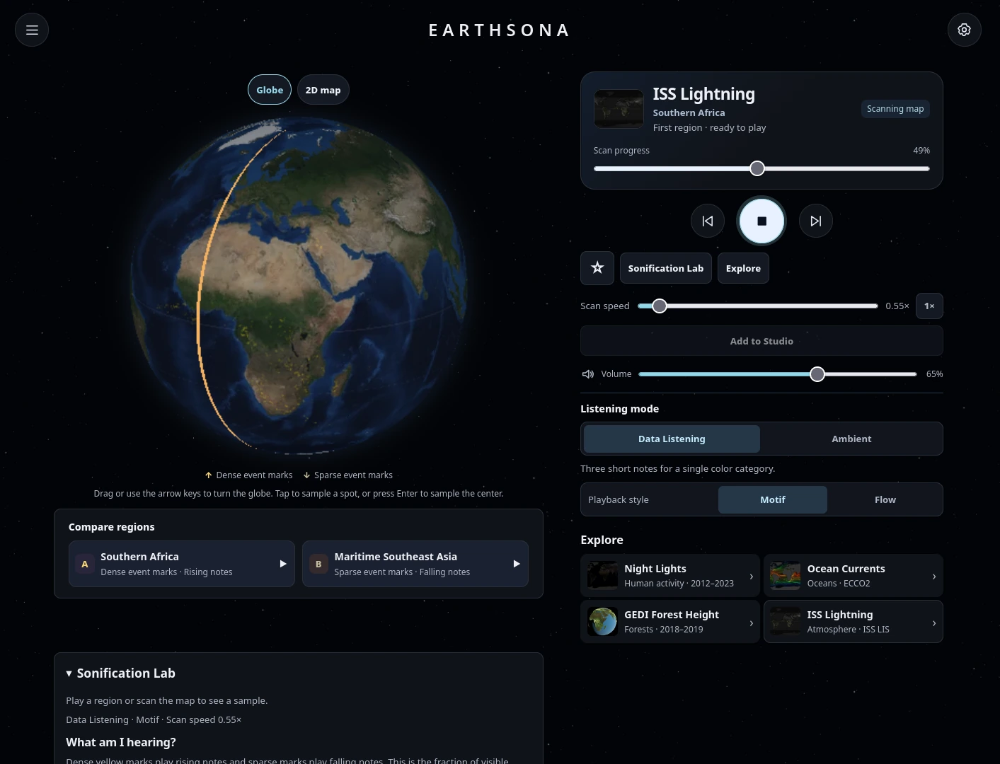
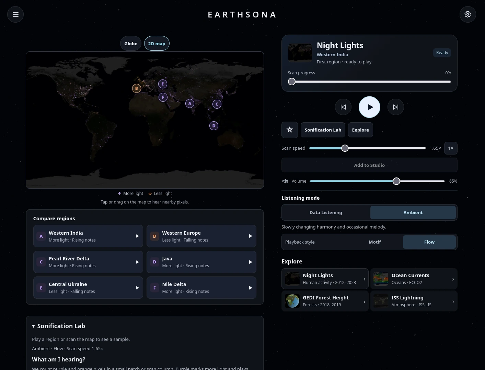
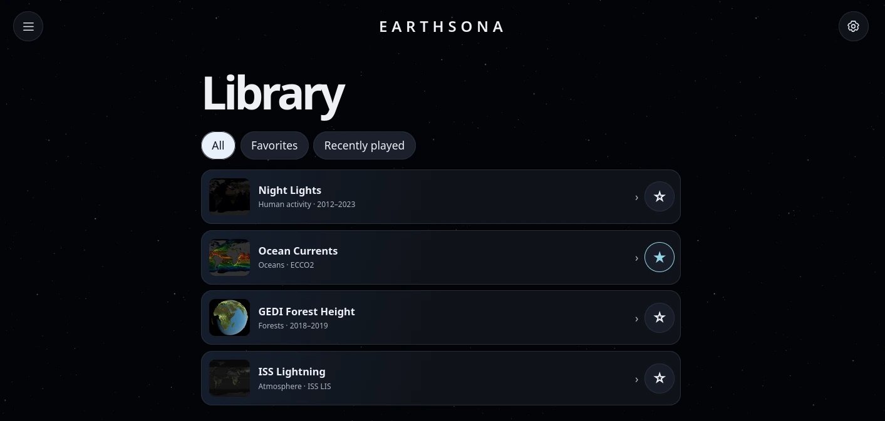
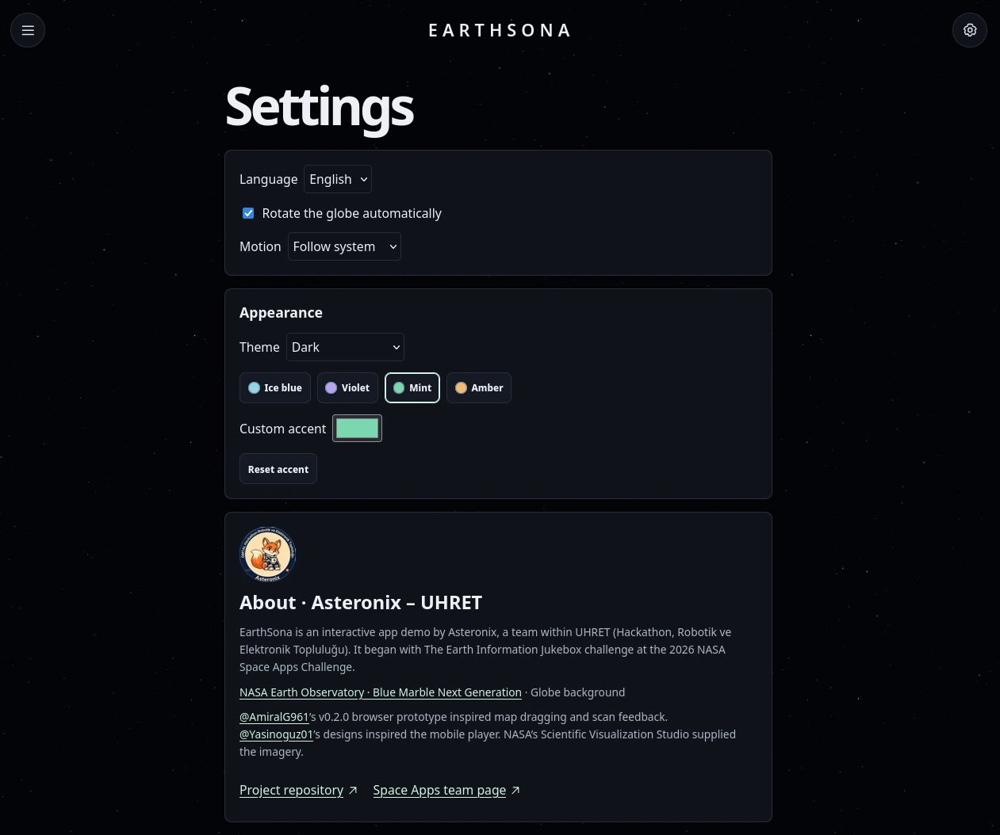

# EarthSona

**Listen to your planet.**

EarthSona is an open-source Earth music player and scientific sonification platform for listening to, exploring, and understanding our planet through sound. Today it turns archived Earth visualizations into music in your browser. Quantitative sonification is a planned extension.

[Open EarthSona](https://earthsona.netlify.app/) · [Roadmap](ROADMAP.md) · [Dataset guide](docs/DATASETS.md) · [Contributing](CONTRIBUTING.md) · [Security reporting](SECURITY.md)

<p><a href="docs/screenshots/iss-lightning-globe.webp"></a><br><em>ISS Lightning on the globe</em></p>

## Listen, explore, create

- **Listen.** Pick a region, tap or drag on the map, or let the Player scan across the image in a loop. Try Data Listening for a clear pitch contour or Ambient for a softer arrangement. Play/Stop and Escape stop playback. Automatic scan samples full columns. Select a map point to scan along its row or latitude, and use the position slider to audition another point on that route. The Player and Sonification Lab share the transport and speed setting, from 0.25× to 5×.
- **Explore.** Browse four NASA visualizations in Explore and revisit favorites or recently played datasets in Library. Use the region presets to compare samples, or open Sonification Lab to see the current sample, pixel coverage, and an explanation of the mapping. Aligned images can be explored on the globe or a flat map. The Player falls back to 2D if it cannot initialize the globe.
- **Create.** Add a sampled contour to Studio as notes derived from the Data Listening motif. Edit pitches and tempo in a 16-step sequencer, preview the loop, and download mono 48 kHz, 16-bit PCM WAV. WebM / Opus appears when the browser reports support for that recording format.

Settings includes English and Turkish, light and dark themes including an AMOLED theme, custom accents, and motion and globe rotation controls. Preferences, favorites, recents, and one editable composition are stored in the browser. Sampling, playback, and export run locally without an account.

## How the images become sound

EarthSona looks at a small patch around the selected point or a column of the image during an automatic scan. Each dataset defines which pixel colors count toward its signal. In Night Lights, for example, qualifying purple pixels produce a rising melody and orange pixels a falling one. Coverage can widen the interval between notes. Motif plays short phrases and Flow links successive samples, adding a sustained harmonic layer in Ambient. RGB Chords uses average blue, green, and red values from the source pixels to shape three simultaneous voices in low, middle, and high registers.

| Dataset | What the sound follows | Display |
| --- | --- | --- |
| Night Lights | Purple for increased light, orange for decreased light between 2012 and 2023. Balanced strong classes produce a mixed contour. | Globe and 2D |
| Ocean Currents | Warm and cool colors in an ECCO2 still of surface currents colored by temperature. | Globe and 2D |
| GEDI Forest Height | Approximate taller and shorter canopy color classes in a rendered still. | 2D |
| ISS Lightning | Dense and sparse coverage of visible yellow marks in a Science on a Sphere still. | Globe and 2D |

The percentages in the Lab describe the sampled image pixels. They cannot be read as physical measurements such as degrees, meters, or lightning event counts. Future quantitative sonification would sample scientific rasters with documented units, missing-data handling, and normalization. See the [dataset guide](docs/DATASETS.md) for sources, processing, and mapping.

To hear the difference quickly, choose Night Lights, Data Listening, and Motif. Try Western India for a rising phrase and Western Europe for a falling one. Select **Add to Studio** after a usable sample to edit its notes.

## Screenshots

Select an image to open it at full size. The screenshots show the main views. Some controls and styling have since evolved.

<p><a href="docs/screenshots/night-lights-2d.webp"></a><br><em>Night Lights in 2D</em></p>

<p><a href="docs/screenshots/sonification-lab.webp"></a><br><em>Sonification Lab</em></p>

<p><a href="docs/screenshots/studio.webp"></a><br><em>Studio loop editor</em></p>

<details>
<summary>Explore, Library, and Settings</summary>

<p><a href="docs/screenshots/explore.webp"></a><br><em>Explore the dataset catalog</em></p>

<p><a href="docs/screenshots/library.webp"></a><br><em>Library favorites and recent datasets</em></p>

<p><a href="docs/screenshots/settings.webp"></a><br><em>Language, motion, and appearance settings</em></p>

</details>

## Run locally

Use Node.js 22.12 or later in the Node 22 line.

```sh
git clone https://github.com/grassified/EarthSona.git
cd EarthSona
npm ci
npm run dev -- --host 127.0.0.1
```

Open the address Vite prints, usually `http://127.0.0.1:5173/`. Serve the app over HTTP so Vite can transform the TypeScript entry point and the browser can load the assets.

```sh
npm test
npm run build
npm run preview -- --host 127.0.0.1
```

The build runs the TypeScript check and writes the static Vite output to `dist/`. Preview serves that output, usually at `http://127.0.0.1:4173/`. After installation, the local build serves the bundled imagery and audio code. External source links require internet access. The Node tests cover sampling, projection, Flow scheduling logic, and the shared composition beat grid. See the [roadmap](ROADMAP.md) for browser, device, accessibility, and listening checks.

See the [deployment guide](docs/DEPLOYMENT.md) for static hosting and browser parity checks.

## How the app is organized

EarthSona is a static TypeScript app built with Vite. [The entry module](src/main.ts) coordinates views, app state, image loading, and playback. [The dataset catalog](src/datasets.ts) defines images, classifiers, and presets. [Sampling](src/sampling.ts) reads the original image pixels, and [projection](src/projection.ts) maps globe picks into the same source image space used in 2D.

[The Web Audio player](src/audio.ts) shares a session across Player, Lab, and Studio preview. [The scheduler](src/scheduled-audio.ts) uses a short scheduling horizon and reusable voices during scans. Studio preview and the on-demand [export renderer](src/studio-export.ts) use the same [composition beat grid](src/composition.ts). See the [maintenance guide](AGENTS.md) for the invariants across these modules.

## Project history and credits

Asteronix, a team within UHRET (Hackathon, Robotik ve Elektronik Topluluğu), started EarthSona for [The Earth Information Jukebox](https://www.spaceappschallenge.org/2026/challenges/the-earth-information-jukebox/) at the 2026 NASA Space Apps Challenge. Asteronix and UHRET are part of the project's identity as it continues independently and welcomes open-source contributors. EarthSona is an independent project without NASA endorsement.

[@AmiralG975f](https://github.com/AmiralG975f)'s v0.2.0 browser prototype inspired map dragging and scan feedback. [@Yasinoguz01](https://github.com/Yasinoguz01)'s designs inspired the mobile Player. NASA's Scientific Visualization Studio supplied the four dataset images and NASA Earth Observatory supplied the Blue Marble backdrop. [Asset credits](docs/DATASETS.md)

The app code uses the [GNU General Public License, version 3](LICENSE). Third-party imagery retains its own attribution and applicable terms. To help shape EarthSona, see the [contributor guide](CONTRIBUTING.md) and [public issue tracker](https://github.com/grassified/EarthSona/issues).
